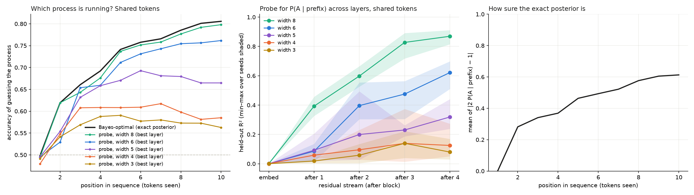
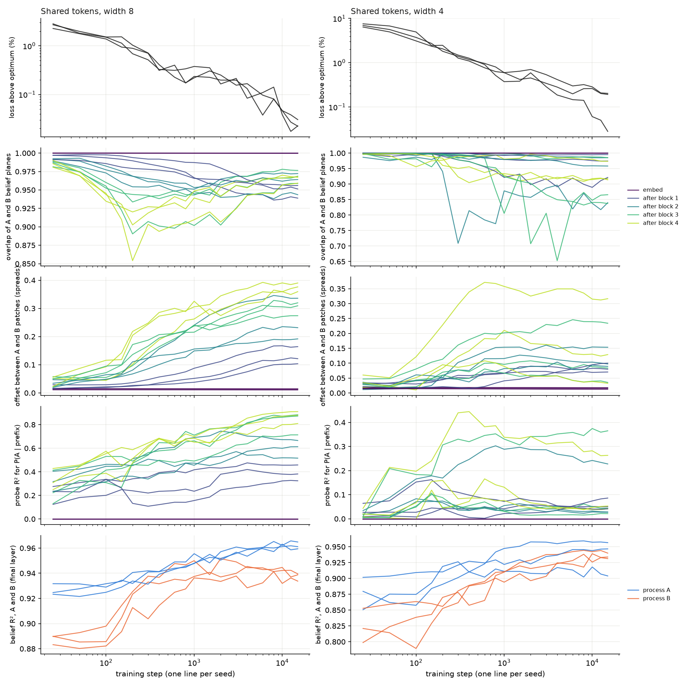

# Squeezing belief geometries

Reproducing the belief-state simplex of Shai et al. (2024) in a small transformer, then squeezing it:
what happens to the simplex when the residual stream is too narrow to hold it, and when two processes
must share a stream with room for one but not both?

The short answer: **the model keeps what its output needs and, as room runs out, gives up the rest,
cheapest first.** The limit is set by what the output layer can read, not by how many directions fit in the space.


## Background

While at the Iliad Intensive I was introduced to the paper
[_Transformers Represent Belief State Geometry in their Residual Stream_](https://arxiv.org/abs/2405.15943)
(Shai et al. 2024). The image of a hidden Markov model encoded in the network is striking. Seeing the
belief-state simplex in the residual stream gives strong support to the idea that training learns models of
beliefs about the hidden state, updated optimally, as predicted in theory (at least in some simple cases).

I wanted to get my hands dirty: to see whether I could reproduce these results, with the assistance of
Claude, and then extend the code to ask some simple follow-up questions.

During the Intensive I was also introduced to a version of the _superposition hypothesis_ of
[Elhage et al. (2022)](https://transformer-circuits.pub/2022/toy_model/index.html), which suggests that in
deep networks it is typical for some linearly represented features not to be orthogonal. The cartoon picture
is trying to squeeze more than $`n`$ vectors into $`\mathbb{R}^n`$: they can't all be mutually orthogonal.

I'm interested in better understanding how this squeezing works in the setting of Shai et al.

## Summary

**The main finding.** The model keeps what the next-token prediction needs and, as room runs out, gives
up everything else, cheapest first. Each experiment shows a different piece of this:

- **Reproduction.** A 4-layer transformer trained on the Mess3 process carries the fractal belief simplex
  in its final residual stream ($`R^2 = 1.00`$ on held-out prefixes); shuffling beliefs before fitting gives
  $`R^2 = 0.00`$.
- **One process, too narrow.** Fine fractal detail goes first, at almost no cost in loss. The simplex
  survives down to width 4 and fails at width 3, where the decoded beliefs collapse onto a curve. The
  threshold matches what the output layer can read: after LayerNorm, a model of width $`d`$ can produce a
  family of predictions with at most $`d-2`$ parameters, and Mess3 needs 2.
- **Two processes at once (dense).** As width falls, the model drops one process entirely, and it is the
  one whose memory is worth ~30 times less in loss. Dropping it costs almost exactly what that memory is
  worth (0.50% of the optimal loss).
- **Two processes, one at a time (sparse).** Both survive to width 4. With one shared set of tokens the two
  beliefs collapse onto a single plane at every width, even with room for two, because the output needs
  only one prediction, and it costs nothing measurable.
- **Which process is running?** With room to spare (width 8) the model also tracks which process is
  running, as well as an optimal observer can, in one extra direction. Squeezed, that is the first thing to
  go: at width 4 the model learns it early in training and then gives it up.
- **Packing was the wrong lens.** I expected the Grassmannian packing problem to describe how the beliefs
  share the space. It mostly does not: when both beliefs are kept their planes are near-orthogonal, but
  the readout limit always binds first, and in the sparse case the problem is not a packing problem at all.

## Why this matters

Two lessons from this toy setting may be worth testing more widely.

- **Whether a latent variable is represented depends on room, not only on whether it is useful.** The same
  training gives a model that tracks which process is running (width 8) and one that learns it briefly and
  then gives it up (width 4) while staying within 0.15% of the optimal loss, because the output does not
  need it. So a
  probe that finds nothing in a narrow model says little about whether the variable matters to the task or
  can be learned, and a signal found in a wide model need not survive in a narrower one. Methods that look
  for latent knowledge with probes need to allow for this.
- **What gets superposed or dropped is decided by the readout.** The two behaviours of Elhage et al.'s
  toy models reappear: dense features force the least valuable one out, sparse ones share directions. But
  here what decides is what the output needs and what each piece is worth, not how many vectors fit in the
  space. With separate tokens the sparse patches are told apart by an offset supplied by the token
  embeddings; with shared tokens they share one plane outright.

These are small models trained on a toy process; whether the lessons carry over is an open question.

## Setup

**Process.** Mess3, the process used by Shai et al., is a hidden Markov model with 3 hidden states and 3 tokens,
parametrised by $`(x, \alpha)`$. The *belief* $`\eta`$ is the posterior over hidden states given the tokens
seen so far; it lives in a triangle, and over all prefixes it traces out a fractal.

**Model.** A pre-LayerNorm transformer: 4 layers, 1 attention head ($`d_\text{head} = 8`$),
$`d_\text{mlp} = 256`$, context 10, trained with Adam (learning rate $`10^{-3}`$, batch 256, cosine schedule)
on freshly sampled sequences: 20,000 steps for one process, 15,000 for two. Only the residual width
$`d`$ (`d_model`) is varied. Width 64 is the size used by Shai et al.

**Simplex images.** For every distinct prefix of every length-10 sequence, take the final residual stream
(before the last LayerNorm), fit an affine ridge map to the exact belief on half the prefixes, and plot the
other half in the triangle, coloured by the true belief. Two numbers go with each image:

- **$`R^2`$**: fraction of belief variance recovered on held-out prefixes.
- **Beyond last token**: the last token alone predicts about 68% of a Mess3 belief, which gives three
  coarse blobs. This measures how much of the rest, the fine structure that needs memory of earlier tokens,
  the model captures: $`(R^2 - R^2_\text{last})/(1 - R^2_\text{last})`$, where $`R^2_\text{last}`$ comes from
  predicting the belief from the last token alone. 1 is perfect; 0 or below means no memory beyond the
  last token. Images clip it at 0; the tables give the raw value.

**Loss above optimum** is the model's next-token cross-entropy relative to the Bayes-optimal predictor,
scored on the same sequences.

**Two processes.** Process A has $`(x, \alpha) = (0.05, 0.85)`$ and B has $`(0.15, 0.60)`$. In the **sparse**
regime each sequence comes from one process, chosen at random. It comes in two versions: with **separate
tokens** for each process (6 in all), so every token reveals the process, and with one **shared** set of 3
tokens, so the model must infer the process from the statistics of what it has seen. In the **dense** regime
both run side by side, and each token is the pair of their tokens (9 in all).

All numbers are means over 3 seeds, with [min, max] where useful; images are seed 0.

## 1. Reproducing the simplex

The top row of the figure above shows the ground truth (left) and the width-64 model (second). The decoded
beliefs recover the fractal, $`R^2 = 1.00`$ and 0.99 beyond the last token, and loss is within 0.01% of
optimal. The control (third) refits after shuffling which belief goes with which activation: everything
collapses to the centre, $`R^2 = 0.00`$ [−0.01, 0.01]. The image is a property of the trained network, not of
the fitting procedure.

## 2. One process in a stream too narrow for it

| Width | $`R^2`$ | Beyond last token | Loss above optimum |
| --- | --- | --- | --- |
| 64 | 1.00 | 0.99 [0.99, 0.99] | 0.01% |
| 8 | 0.98 | 0.92 [0.91, 0.93] | 0.01% |
| 4 | 0.93 | 0.78 [0.78, 0.79] | 0.08% [0.05, 0.13] |
| 3 | 0.75 | 0.22 [0.03, 0.40] | 1.9% [1.4, 2.8] |
| 2 | 0.61 | −0.24 [−0.67, 0.00] | 37% |

Width 8 keeps much of the fractal detail. Width 4 keeps the triangle and most of the memory, at almost no
cost in loss. Width 3 breaks: the decoded beliefs collapse onto a one-dimensional curve through the
triangle, and the seeds disagree on how much survives. Width 2 shows three blobs, one per last token.

**Why width 4.** Every read of the residual stream goes through a LayerNorm, which removes the mean
coordinate and then normalises to a sphere. So the output head sees a point on a sphere of dimension $`d - 2`$,
and the next-token distributions a model of width $`d`$ can produce form a family with at most $`d-2`$ parameters.
For Mess3 the optimal prediction is an invertible affine function of the belief, so the optimal predictions
form a 2-parameter family. If the model's prediction varies smoothly with the belief, exact prediction then
needs $`d - 2 \ge 2`$, i.e. $`d \ge 4`$. At $`d = 3`$ the head sees a circle, a 1-parameter family, which matches
the curve in the width-3 image. This is a heuristic, not a theorem: with a context of 10 there are only finitely
many beliefs, and nothing forces the network's map from prefixes to predictions to be smooth. The curve is
also in the residual stream before the LayerNorm, which is not forced to be one-dimensional, so it is
consistency rather than proof. The argument and its assumptions are in the
[theory](THEORY.md#which-space-layernorm).

**Width 2 is a different failure.** At $`d = 2`$ the LayerNorm sends a line to two points, so it is a sign
function with zero derivative (up to its small $`\epsilon`$). No gradient reaches the residual stream, and only
the output head trains. All three width-2 models, here and below, end up close to the uniform predictor:
loss $`\approx \ln 3`$, $`\ln 6`$ and $`\ln 9`$ gives 38%, 90% and 16% above optimum, against measured 37%, 90%
and 16%. The three blobs in the image come from the untrained embeddings and layers, which still carry the last token.

## 3. Two processes in a stream with room for one


Beyond last token, per process:

| Width | Sparse A | Sparse B | Dense A | Dense B |
| --- | --- | --- | --- | --- |
| 8 | 0.96 | 0.89 | 0.94 | 0.74 |
| 6 | 0.94 | 0.85 | 0.85 | 0.22 [0.11, 0.30] |
| 5 | 0.94 | 0.69 | 0.80 | −1.70 |
| 4 | 0.91 | 0.54 [0.51, 0.60] | 0.75 | −3.35 |
| 3 | −0.34 | 0.08 | 0.44 [0.36, 0.50] | −3.76 |

(Sparse here means separate tokens; the shared-token version is below.)

Loss above optimum:

| Width | 8 | 6 | 5 | 4 | 3 | 2 |
| --- | --- | --- | --- | --- | --- | --- |
| Sparse, separate tokens | 0.02% | 0.03% | 0.04% | 0.14% | 1.6% | 90% |
| Sparse, shared tokens | 0.01% | 0.03% | 0.05% | 0.15% | 2.0% | 13% |
| Dense | 0.03% | 0.07% | 0.28% | 0.50% | 1.6% | 16% |

**Sparse: both survive to width 4,** with B losing detail first, and both fail at width 3. This is the
same threshold as for one process. Only one process is active at a time, so the model never needs more than
one 2-parameter family of predictions at once.

**Dense: one process is given up.** B is already weak at width 6 and gone below it. The large negative
values mean the decoder cannot even recover B's last token: B is dropped, not kept at low resolution.
A survives down to width 3. Two beliefs active at once need a 4-parameter family of predictions, so by the
same heuristic exact prediction needs $`d \ge 6`$; in practice width 6 is not quite enough.

**Why B.** `memory_value.py` measures what each process's history is worth in next-token loss:

| Process | Value of the last token | Value of memory beyond it |
| --- | --- | --- |
| A, $`(0.05, 0.85)`$ | 0.239 nats | 0.061 nats |
| B, $`(0.15, 0.60)`$ | 0.008 nats | 0.002 nats |

B's history is worth about 30 times less, so it is the cheap one to drop. The numbers agree: dropping B
entirely costs $`0.0095`$ nats, which is 0.50% of the dense optimal loss, and the width-4 dense models sit at
0.50% above optimum. They predict A almost perfectly and B not at all.

### Sparse with one shared set of tokens


| Width | Separate tokens: A | Separate tokens: B | Shared tokens: A | Shared tokens: B |
| --- | --- | --- | --- | --- |
| 8 | 0.96 | 0.89 | 0.78 [0.76, 0.80] | 0.69 [0.67, 0.70] |
| 6 | 0.94 | 0.85 | 0.75 [0.73, 0.79] | 0.66 [0.61, 0.71] |
| 5 | 0.94 | 0.69 | 0.73 [0.70, 0.78] | 0.68 [0.67, 0.69] |
| 4 | 0.91 | 0.54 | 0.63 [0.45, 0.75] | 0.67 [0.65, 0.70] |
| 3 | −0.34 | 0.08 | 0.11 [−0.17, 0.37] | 0.11 [−0.13, 0.34] |

(Beyond last token, per process.) With shared tokens, both beliefs still survive down to width 4 and fail
at width 3, the same threshold as before: whichever process is running, the prediction is a distribution
over the same 3 tokens, a 2-parameter family. B holds up better than with separate tokens (0.67 against
0.54 at width 4). Loss is as close to optimal as with separate tokens (0.15% above at width 4, against
0.14%; table above), even though the optimal predictor now has to weigh up which process is running.

The scores are lower at the wider widths, but this does not mean the model is worse. Each process's belief
is computed as if the process were known. With shared tokens the model cannot know it, especially early in
a sequence, so even the Bayes-optimal predictor would not carry these beliefs exactly, and the ceiling is
below 1.

The geometry is the striking part: see [section 4](#4-geometry-is-it-a-packing-problem).

## 4. Geometry: is it a packing problem?

Each belief occupies a 2-dimensional plane in the residual stream: the directions the activation moves as
that belief moves. The *overlap* of two planes is the mean $`\cos^2`$ of their two principal angles (0 for
orthogonal planes, 1 for identical ones). Planes are measured in the part of the stream that LayerNorm can
see, which has dimension $`d - 1`$.

The starting hypothesis was the cartoon of superposition: two beliefs squeezed into too little room should
arrange their planes as an optimal Grassmannian packing, as far apart as the space allows. **This turned
out to be mostly the wrong lens.** When both beliefs are kept, their planes are indeed near-orthogonal,
but that happens only at widths where orthogonality is easy, and the readout limit binds before packing
ever does. In the sparse case the problem is not a packing problem at all.


Largest overlap between the two belief planes, final layer, among models that represent both
(held-out $`R^2 \ge 0.5`$):

| Width | Optimum | Two random planes (mean) | Sparse, separate tokens | Offset separation | Sparse, shared tokens | Offset separation | Dense |
| --- | --- | --- | --- | --- | --- | --- | --- |
| 3 | 1 | 1 | 1.00 | 2.4 | 1.00 | 0.05 | – |
| 4 | 0.50 | 0.67 | 0.75 [0.60, 0.93] | 5.9 | 0.94 [0.92, 0.97] | 0.17 | – |
| 5 | 0 | 0.50 | 0.29 [0.23, 0.37] | 6.0 | 0.905 [0.897, 0.914] | 0.21 | 0.26 (1 seed) |
| 6 | 0 | 0.40 | 0.14 [0.03, 0.23] | 6.0 | 0.94 [0.92, 0.98] | 0.33 | 0.013 [0.003, 0.025] |
| 8 | 0 | 0.29 | 0.11 [0.09, 0.13] | 5.9 | 0.97 [0.96, 0.97] | 0.38 | 0.020 [0.003, 0.039] |

In the γ-metric the same entries are, by width 4, 5, 6, 8: separate tokens 0.72, 0.28, 0.15, 0.08; shared
tokens 0.93, 0.905, 0.94, 0.97; dense –, 0.36, 0.021, 0.015.

*Offset separation* is the distance between the centres of the two processes' activation patches, divided
by their typical spread. *Two random planes* is the expected overlap of independent random planes,
$`2/(d-1)`$.

**Dense: near the optimal packing.** Whenever both beliefs are kept (all seeds at widths 6 and 8), their
planes are nearly orthogonal: overlap about 0.01–0.02, against 0.3–0.4 for random planes. Two planes fit
orthogonally once $`d - 1 \ge 4`$, i.e. $`d \ge 5`$, so packing is not what limits the dense models: the readout
bound $`d \ge 6`$ is reached first. At width 5 only one seed keeps B at all, and that model's planes overlap
noticeably (0.26).

Two cautions. First, the comparison never reaches the regime where packing is constrained: no dense model
keeps both beliefs at a width where orthogonal planes are impossible. Second, near-orthogonality has a
simpler possible cause than packing pressure. The optimal logits for A and B lie in orthogonal subspaces of
logit space ([theory](THEORY.md#the-softmax-and-why-it-favours-linear-structure)), so planes that the output
head maps onto them through a reasonably well-conditioned map come out nearly orthogonal anyway. The data
cannot tell these apart.

**Sparse, separate tokens: not a packing problem.** Overlaps are far above the optimum, and at width 4
above even the random baseline, yet both processes are decoded well and loss is within 0.14% of optimal.
The two belief patches share directions but sit about 6 spreads apart, so position, not direction, tells
them apart. Only one patch is active at a time, so nothing forces their directions apart. Even at width 3,
where the two planes must coincide, the patches are still separated (2.4 spreads); the failure there is the
readout bound, not a collision.

**Sparse, shared tokens: one plane for two beliefs.** Remove the separate tokens and the separation goes
with it: the offset drops from about 6 spreads to 0.05–0.4, so the 6 spreads came from the token
embeddings, not from anything the model had to learn. The planes coincide too, with overlap 0.9–0.97 at
every width, including width 8, where there is room for orthogonal planes and for a separate offset. The
model is not squeezed into sharing; it chooses one plane for both beliefs, and loses nothing measurable by
doing so (loss within 0.15% of optimal down to width 4).

A natural reading: whichever process is running, the next-token prediction is a distribution over the same
3 tokens, and one plane can carry it for both. Each process's belief maps to that prediction by an
invertible affine map, so each belief is linearly decodable from the shared plane once the process is
known, and the two decoders find the same plane. This is consistent with the final layer holding mainly the
next-token prediction, not two separate beliefs. The decoders here are told which process produced each
sequence; [section 5](#5-disentangling-does-the-model-know-which-process-it-is-in) asks whether the model
itself tracks the process.

**Robustness.** Angles depend on the choice of inner product. Recomputed in the metric the output head's
LayerNorm imposes (the γ-metric), and with planes fitted on optimal logits instead of beliefs, the
conclusions are unchanged. The two fits find the same plane for every represented process (agreement
≥ 0.999). See [What is measured](THEORY.md#what-is-measured).

## 5. Disentangling: does the model know which process it is in?

With shared tokens nothing tells the model which process produced a sequence. The exact posterior
$`\pi = P(A \mid \text{prefix})`$ says how far the evidence has gone, and it goes less far than one might
expect: guessing the process from $`\pi`$ is right only 62% of the time after two tokens and 81% after ten.
The full belief therefore lives in the 5-simplex over (process, state), the *join* of the two triangles, and
$`\pi`$ says where along the join it sits. `disentangle.py` asks two questions about how the model handles
this.

### What to expect

- **Identification is slow.** For an optimal observer the log-odds between two processes grow, on average,
  linearly in the number of tokens, at a rate set by how statistically distinguishable the processes are,
  so the posterior concentrates exponentially. A and B are similar, and within a context of 10 the exact
  posterior gets only as far as the Bayes accuracies above. That curve, not 100%, is the benchmark for any
  probe.
- **Two candidate geometries.** Shai et al. (2024) find that the residual stream carries the full belief
  state, not just the next-token prediction. Here that is the 5-dimensional joint belief, with coordinates
  $`(\pi, \eta_A, \eta_B)`$. The output, by contrast, needs only the 2-dimensional prediction
  $`\pi\, \eta_A N_A + (1 - \pi)\, \eta_B N_B`$, in which $`\pi`$ is already folded. So the final layer could
  hold anything from the 2-dimensional prediction up to the full 5-dimensional belief.
- **Mixture, not product.** The dense regime is a factorial HMM (Ghahramani & Jordan 1997): its belief
  is a product of the two processes' beliefs, so there is nothing to disentangle. The sparse regime with
  shared tokens is a mixture, whose belief lives on the join. Disentangling here therefore means tracking
  $`\pi`$, not separating two independent beliefs.
- **"One model, then two" during training.** Several settings learn a merged description first and split
  it later: causal-state splitting reconstructs a process's minimal predictive model by starting from one
  state and splitting it when histories predict differently (Shalizi & Klinkner 2004); in deterministic
  annealing, cluster centres split at critical temperatures (Rose 1998); and deep networks often learn in
  stages (Saxe, McClelland & Ganguli 2019; Hoogland et al. 2024). This suggests the hypothesis tested below:
  the shared-token model first learns one averaged process, then splits into two.
- **What competes for room.** In the toy models of Elhage et al. (2022), which features a model represents
  depends on their value relative to the dimensions available. Here $`\pi`$ competes with the prediction
  for the $`d - 2`$ dimensions the output head can use (section 2), and the prediction is worth far more.

### Does it track the process?

A ridge probe is fitted from the residual stream to $`\pi`$ at every layer, on the shared-token models of
section 3.



| Width | 8 | 6 | 5 | 4 | 3 |
| --- | --- | --- | --- | --- | --- |
| Probe $`R^2`$ for $`\pi`$, final layer | 0.87 | 0.62 | 0.32 | 0.12 | 0.08 |
| Probe accuracy after 10 tokens (Bayes: 0.806) | 0.798 | 0.762 | 0.665 | 0.585 | 0.563 |
| Loss above optimum | 0.01% | 0.03% | 0.05% | 0.15% | 2.0% |

(Means over 3 seeds; accuracy uses each model's best layer. All from `results/disentangle/probe.json`.)

At width 8 the model tracks the process essentially as well as possible: its probe follows the Bayes-optimal
accuracy at every position. The posterior is built up through the layers ($`R^2`$ 0.39, 0.60, 0.83, 0.87 after
blocks 1–4). Combined with section 4, the final layer holds **one shared belief plane plus a separate
direction for $`\pi`$**, as far as linear probes can tell: between the two candidate geometries, nearer the
low-dimensional end, and not two separate belief models. (Because each plane is fitted on its own process's
sequences, the experiment cannot rule out that further directions carry $`\eta_A`$ and $`\eta_B`$
separately.) As a control, with separate tokens the probe reaches $`R^2 = 0.98`$, because the first
token gives the process away.

As the stream narrows, process tracking is the first thing to go. Loss stays within 0.15% of optimal down to
width 4, but the probe falls to $`R^2 = 0.12`$ and its accuracy stalls after a few tokens. This fits the
readout argument of section 2: the output head has $`d - 2`$ dimensions, the prediction needs 2, and only
what is left can carry $`\pi`$. At width 4 nothing is left, and the small remaining signal may be what the
prediction itself reveals (A's predictions are more peaked than B's). Dropping $`\pi`$ costs little: the
optimal prediction already mixes the two processes' predictions in proportion to $`\pi`$, so the
posterior is folded into the prediction, and later positions can recompute it through attention.

### Does training learn one model and then split it?

Shared-token models at widths 8 and 4 (3 seeds each) were retrained with 19 snapshots between steps 25 and
15,000 (the last is the finished model), and every snapshot was analysed in the same way.



| Step | 25 | 200 | 400 | 1,000 | 4,000 | 15,000 |
| --- | --- | --- | --- | --- | --- | --- |
| Width 8: loss above optimum | 2.6% | 0.87% | 0.35% | 0.28% | 0.13% | 0.03% |
| Width 8: plane overlap (final layer) | 0.99 | 0.89 | 0.92 | 0.93 | 0.95 | 0.96 |
| Width 8: offset (spreads) | 0.04 | 0.17 | 0.25 | 0.30 | 0.34 | 0.38 |
| Width 8: probe $`R^2`$ for $`\pi`$ | 0.33 | 0.53 | 0.68 | 0.68 | 0.79 | 0.87 |
| Width 4: loss above optimum | 7.0% | 2.1% | 1.2% | 0.52% | 0.30% | 0.14% |
| Width 4: probe $`R^2`$ for $`\pi`$ | 0.02 | 0.17 | 0.20 | 0.18 | 0.13 | 0.12 |

The hypothesis is not borne out: the network never splits into two independent models.

- **Width 8: one model gains a coordinate.** The probe for $`\pi`$ rises steadily over training, and the
  offset between the A and B patches grows with it: the activations shift along a direction that tracks
  the process. The two belief planes stay nearly identical throughout. They separate a little around steps
  150–400, while loss is falling fastest (overlap down to 0.89 on average, 0.85 in one seed), then merge back
  to 0.96. The closest thing to a split is this transient, and it reverses.
- **Width 4: learned, then given up.** The probe rises to about 0.2 by step 600 (0.44 in one seed) and then
  falls back to 0.12, and the offset does the same (0.22, then 0.16), while loss keeps improving. The model
  tracks the process early and lets it go as it sharpens the prediction, which fills its two usable
  dimensions. A feature is learned and then squeezed out by a more valuable one.
- **No sharp transition.** Loss falls smoothly at this snapshot resolution; nothing looks like a sudden
  phase change.

Two cautions. Early in training the planes overlap almost completely for free, since both beliefs are
driven by the same token embeddings, so only a later drop would count as a split. And the probe's early
$`R^2`$ (0.33 at step 25 at width 8) is largely free too: $`\pi`$ depends mainly on simple token statistics,
such as how often tokens repeat, which even a barely trained network partly encodes.

## Theory in brief

The full derivations are in [THEORY.md](THEORY.md). The essentials:

- **Belief planes.** Following Shai et al., activations embed each process's belief affinely,
  $`a \approx m_k + M_k(\eta - c)`$. The directions a belief moves the activation along form a plane,
  a point of a Grassmannian; the belief itself fills a patch of that plane.
- **The model reads a sphere.** Every read of the residual stream goes through a LayerNorm, which discards
  the all-ones direction and normalises. The usable space has dimension $`d - 1`$, and the output head sees
  a sphere of dimension $`d - 2`$.
- **Readout bound.** The output head is smooth, so the predictions a model of width $`d`$ can make have
  (Hausdorff) dimension at most $`d - 2`$. Exact prediction needs $`d - 2`$ to be at least the dimension of
  the set of optimal predictions: 2 for one process or for a sparse pair, 4 for a dense pair. This is a
  theorem for long contexts and a heuristic at context 10, where there are finitely many beliefs.
- **Overlap.** For two planes, the mean $`\cos^2`$ of their principal angles: 0 if orthogonal, 1 if equal.
  Measured in the usable space, in two metrics (Euclidean, and the one the output head's LayerNorm scale
  imposes), and again with planes fitted on optimal logits.
- **Packing.** Two planes can be orthogonal once the usable space has dimension 4, i.e. $`d \ge 5`$. Packing
  matters when both beliefs are read at once (dense): overlapping planes amplify noise in the decode. It
  does not when one process is active at a time (sparse): there the patches only need to be apart.
- **Softmax.** For independent processes the optimal logits are a sum of an A-part and a B-part in
  orthogonal subspaces, so the softmax turns independence into linear structure; with shared tokens both
  processes' predictions live in one 2-dimensional family, which one plane can carry.

| Setting | Readout bound | Packing threshold | Prediction | Observed |
| --- | --- | --- | --- | --- |
| One process | $`d \ge 4`$ | none (one plane) | fractal survives at width 4, breaks at 3 | ✓ Width 4 within 0.08% of optimal; width 3 collapses to a curve, 1.9% above |
| Two, sparse, separate tokens | $`d \ge 4`$ | not required | both survive to width 4; planes may overlap, patches separated by offset | ✓ Both decoded at width 4 (0.14% above optimal); overlap 0.75 vs optimum 0.50; patches ~6 spreads apart |
| Two, sparse, shared tokens | $`d \ge 4`$ | not required | both survive to width 4; one shared plane possible | ✓ Both decoded at width 4, fail at 3; planes coincide (overlap 0.9–0.97) and patches overlap at every width |
| Two, dense | $`d \ge 6`$ | $`d \ge 5`$ | planes near-orthogonal whenever both are kept; readout, not packing, binds | Mostly ✓ Overlap ≈ 0.01–0.02 when both kept; B is already weak at width 6, so the bound is not sufficient; no model keeps both where packing would be constrained |

## Limitations

- **Width changes more than storage.** Shrinking `d_model` shrinks the space the belief is stored in, but
  also the space the network computes the belief update in, while the head size, learning rate and
  training length stay fixed. A failure at width 3 could come from storage, computation or optimisation;
  the large spread between seeds at width 3 suggests optimisation plays a part. The readout argument
  explains the threshold but does not exclude the others.
- **The readout bound is a heuristic at finite context.** See
  [THEORY.md](THEORY.md#which-space-layernorm): it is a theorem only for the long-context limit, and
  depends on the fractal's Hausdorff dimension, which is not computed here.
- **Linear probes only.** Every image and $`R^2`$ is a linear decode. At small widths a belief may still be
  present but encoded nonlinearly, and a linear probe would miss it. This matters for the link to
  superposition, which is about features recovered nonlinearly despite interference.
- **Separate tokens give away the process.** With separate tokens per process, every token says which
  process is running. The shared-token run confirms that the large offset between the patches comes from
  this.
- **Decoders are told the process.** Each process's belief is decoded only on sequences that process
  produced, so a good decode does not by itself show that the model knows which process is running.
  Section 5 probes for the process posterior directly, with linear probes only.
- **Training dynamics are sampled coarsely.** Section 5's development run has 19 snapshots, 3 seeds and two
  widths; a brief transition between snapshots would be missed.
- **The packing comparison is never constrained.** Dense models keep both beliefs only where orthogonal
  planes are possible, and their near-orthogonality may be inherited from the orthogonal structure of the
  optimal logits rather than from pressure to pack.
- **One process pair.** A and B differ a lot in how much their memory is worth, which decides which one is
  dropped. A symmetric pair would test whether the model then shares the cost or still picks one.
- **Images are sensitive to cheap structure.** Width 8 loses visible fractal detail at no measurable cost
  in loss (0.01% above optimal), and width 4 costs 0.08%. The pictures magnify structure that is worth very
  little to the loss.
- **Small scale.** Three seeds, one architecture, fixed training lengths. The dense comparison with packing
  rests on 7 models that keep both beliefs, 6 of them at widths 6 and 8; overlaps are measured only on
  models that keep both, which is a selection.
- **Final layer, partial metric.** Planes and overlaps are measured where the output head reads; earlier
  layers are in the analysis files but not discussed. The γ-metric includes the final LayerNorm's scale but
  not the unembedding $`W_U`$, so it is only part of the geometry the readout imposes.
- **Thresholds.** A process counts as represented if its held-out $`R^2 \ge 0.5`$; the conclusions do not
  hinge on borderline cases except the single dense model at width 5.

## Reproducing

```bash
python -m venv .venv
.venv\Scripts\Activate.ps1          # macOS/Linux: source .venv/bin/activate
pip install -r requirements.txt
python run_simplex.py --steps 300 --seeds 0    # smoke test, a few minutes, blurry images
python run_simplex.py                          # full run: 69 models over seeds 0, 1, 2
python memory_value.py                         # value of each process's memory (seconds)
python disentangle.py probe                    # which-process probe on the trained models (minutes)
python disentangle.py train                    # 6 shared-token models with training snapshots
python disentangle.py develop                  # analyse the snapshots (minutes)
```

`run_simplex.py` trains in parallel, one model per CPU core, skips models already trained, and writes
everything in `results/`. It runs on a CPU; no GPU is needed.

## Files

| File | Purpose |
| --- | --- |
| `THEORY.md` | The mathematics: belief planes, LayerNorm, the readout bound, packing, the softmax |
| `run_simplex.py` | Trains every model and makes every figure and table |
| `processes.py` | Mess3: sampling, exact beliefs, optimal predictions |
| `composite.py` | Two processes, sparse (mixture) or dense (parallel) |
| `model.py`, `train.py` | The transformer and its training loop |
| `fitting.py` | Affine ridge fits |
| `simplex_figures.py` | Simplex images, shuffle control, $`R^2`$ and beyond-last-token |
| `capacity.py` | Belief planes, overlaps (Euclidean, γ-metric, logit coordinates), offset separation |
| `packing.py` | Optimal Grassmannian packings and the comparison figure |
| `memory_value.py` | Value of each process's memory in nats |
| `disentangle.py` | Probe for which process is running; training-dynamics analysis from snapshots |
| `results/` | Figures, `metrics.csv` (every number above, mean/min/max over seeds), per-seed analysis files |

## References

- A. Shai, S. Marzen, L. Teixeira, A. Gietelink Oldenziel, P. Riechers.
  [Transformers Represent Belief State Geometry in their Residual Stream](https://arxiv.org/abs/2405.15943).
  NeurIPS 2024.
- N. Elhage et al. [Toy Models of Superposition](https://transformer-circuits.pub/2022/toy_model/index.html).
  Transformer Circuits Thread, 2022.
- J. H. Conway, R. H. Hardin, N. J. A. Sloane. Packing lines, planes, etc.: packings in Grassmannian spaces.
  *Experimental Mathematics* 5(2), 139–159, 1996.
- R. A. Rankin. The closest packing of spherical caps in n dimensions. *Proceedings of the Glasgow
  Mathematical Association* 2, 139–144, 1955.
- Z. Ghahramani, M. I. Jordan. Factorial hidden Markov models. *Machine Learning* 29, 245–273, 1997.
- C. R. Shalizi, K. L. Klinkner. Blind construction of optimal nonlinear recursive predictors for discrete
  sequences. *Uncertainty in Artificial Intelligence* (UAI), 2004.
- K. Rose. Deterministic annealing for clustering, compression, classification, regression, and related
  optimization problems. *Proceedings of the IEEE* 86(11), 2210–2239, 1998.
- A. M. Saxe, J. L. McClelland, S. Ganguli. A mathematical theory of semantic development in deep neural
  networks. *PNAS* 116(23), 11537–11546, 2019.
- J. Hoogland, G. Wang, M. Farrugia-Roberts, L. Carroll, S. Wei, D. Murfet.
  [Loss Landscape Degeneracy and Stagewise Development in Transformers](https://arxiv.org/abs/2402.02364)
  (first version titled *The Developmental Landscape of In-Context Learning*). arXiv:2402.02364, 2024.

## How this was made

I set the questions and the direction, ran every experiment on my laptop, checked the mathematics and the
numbers, and decided what to keep, cut and follow up. The code and first drafts of the text and derivations
were written with Claude (Anthropic). Several turns in the project came from that checking and questioning:
asking whether the softmax distorts the linear picture, which space the angles should be measured in,
whether separate tokens were giving the process away, and whether a model of two processes starts as one
and later splits in two.

## Acknowledgements

This project grew out of the Iliad Intensive.
