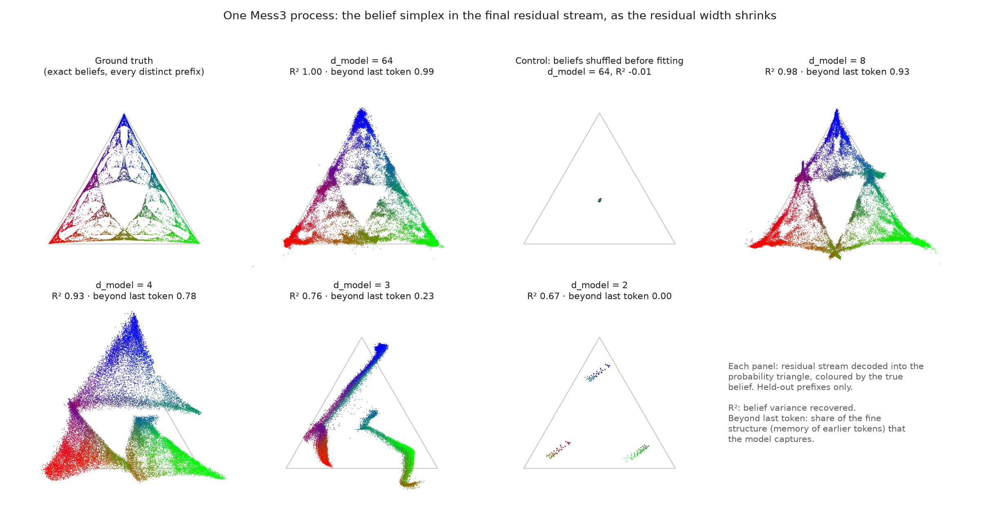
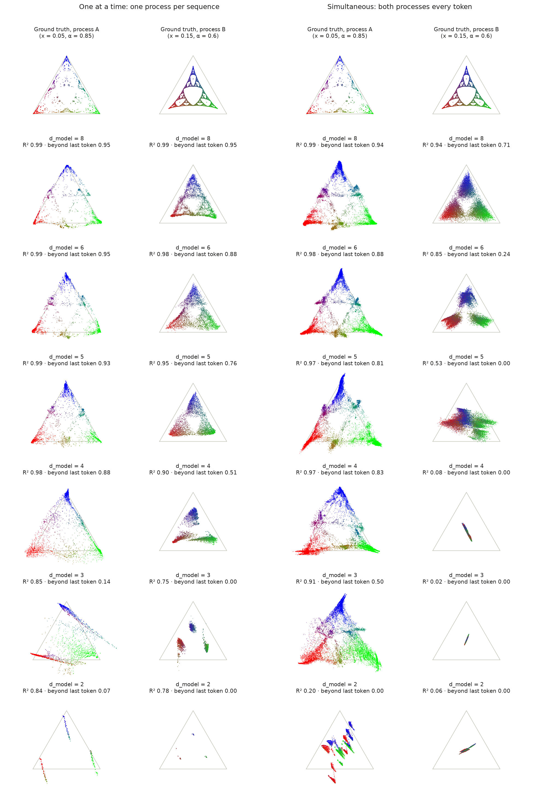
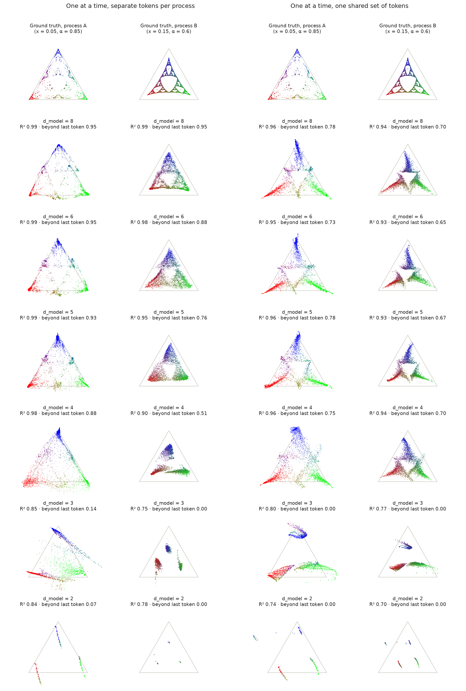
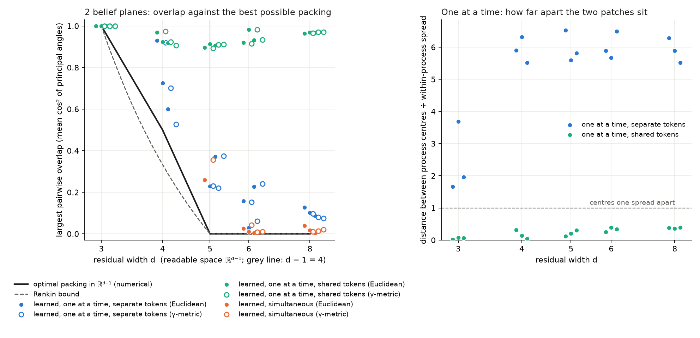

# Squeezing belief geometries

Reproducing the belief-state simplex of Shai et al. (2024) in a small transformer, then squeezing it:
what happens to the simplex when the residual stream is too narrow to hold it, and when two processes
must share a stream with room for one but not both? The learned geometry is compared with the
Grassmannian packing problem.



## Background

While at the Iliad Intensive I was introduced to the paper
[_Transformers Represent Belief State Geometry in their Residual Stream_](https://arxiv.org/abs/2405.15943)
(Shai et al. 2024). The image of a hidden Markov model encoded in the network is striking. Seeing the
belief-state simplex in the residual stream gives strong support to the idea that training learns models of
beliefs about the hidden state, updated optimally, as predicted in theory (at least in some simple cases).

I wanted to get my hands dirty: to see whether I could reproduce these results, with the assistance of
Claude, and then extend the code to ask some simple follow-up questions.

During the Intensive I was also introduced to a version of the _superposition hypothesis_ of
[Elhage et al. (2022)](https://transformer-circuits.pub/2022/toy_model/index.html), which suggests that in
deep networks it is typical for some linearly represented features not to be orthogonal. The cartoon picture
is trying to squeeze more than $`n`$ vectors into $`\mathbb{R}^n`$: they can't all be mutually orthogonal.

I'm interested in better understanding how this squeezing works in the setting of Shai et al.

## Summary

- **Reproduction.** A 4-layer transformer trained on the Mess3 process carries the fractal belief simplex
  in its final residual stream ($`R^2 = 1.00`$ on held-out prefixes). Shuffling beliefs before fitting gives
  $`R^2 = 0.00`$.
- **One process, too narrow.** The simplex degrades gracefully down to width 4 and fails at width 3, where
  the decoded beliefs collapse onto a curve. The threshold matches a LayerNorm argument: if predictions vary
  smoothly with the belief, a model of width $`d`$ can only produce a family of predictions with $`d-2`$
  parameters, and Mess3 needs 2.
- **Two processes.** When only one process is active at a time (*sparse*), both survive down to width 4.
  With separate tokens per process the two belief patches share directions but sit apart; with one shared
  set of tokens they lie on top of each other, in a single plane, at every width. When both are active at
  once (*dense*), the model gives up one process entirely as width falls, and it gives up the one whose
  memory is worth ~30 times less.
- **Packing.** In the dense regime, whenever both beliefs are kept their planes are close to orthogonal,
  the optimal Grassmannian packing. In the sparse regime the overlaps are far above optimal, because the
  sparse problem is an arrangement of affine patches, not a packing of subspaces.
- **Link to superposition.** The regimes show, in this setting, the two behaviours of the toy models of
  Elhage et al. (2022): when features are dense the model keeps the most valuable and drops the rest; when
  they are sparse it lets them share directions. The sharing mechanism differs. In Elhage et al.
  interference is filtered out by a nonlinearity. Here, with separate tokens, the patches are told apart by
  an offset that the token embeddings supply; with shared tokens there is no offset, and the two beliefs
  share one plane even when there is room for two.

## Setup

**Process.** Mess3, the process used by Shai et al., is a hidden Markov model with 3 hidden states and 3 tokens,
parametrised by $`(x, \alpha)`$. The *belief* $`\eta`$ is the posterior over hidden states given the tokens
seen so far; it lives in a triangle, and over all prefixes it traces out a fractal.

**Model.** A pre-LayerNorm transformer: 4 layers, 1 attention head ($`d_\text{head} = 8`$),
$`d_\text{mlp} = 256`$, context 10, trained with Adam (learning rate $`10^{-3}`$, batch 256, cosine schedule)
on freshly sampled sequences: 20,000 steps for one process, 15,000 for two. Only the residual width
$`d`$ (`d_model`) is varied. Width 64 is the size used by Shai et al.

**Simplex images.** For every distinct prefix of every length-10 sequence, take the final residual stream
(before the last LayerNorm), fit an affine ridge map to the exact belief on half the prefixes, and plot the
other half in the triangle, coloured by the true belief. Two numbers go with each image:

- **$`R^2`$**: fraction of belief variance recovered on held-out prefixes.
- **Beyond last token**: the last token alone predicts about 68% of a Mess3 belief, which gives three
  coarse blobs. This measures how much of the rest, the fine structure that needs memory of earlier tokens,
  the model captures: $`(R^2 - R^2_\text{last})/(1 - R^2_\text{last})`$, where $`R^2_\text{last}`$ comes from
  predicting the belief from the last token alone. 1 is perfect; 0 or below means no memory beyond the
  last token. Images clip it at 0; the tables give the raw value.

**Loss above optimum** is the model's next-token cross-entropy relative to the Bayes-optimal predictor,
scored on the same sequences.

**Two processes.** Process A has $`(x, \alpha) = (0.05, 0.85)`$ and B has $`(0.15, 0.60)`$. In the **sparse**
regime each sequence comes from one process, chosen at random. It comes in two versions: with **separate
tokens** for each process (6 in all), so every token reveals the process, and with one **shared** set of 3
tokens, so the model must infer the process from the statistics of what it has seen. In the **dense** regime
both run side by side, and each token is the pair of their tokens (9 in all).

All numbers are means over 3 seeds, with [min, max] where useful; images are seed 0.

## 1. Reproducing the simplex

The top row of the figure above shows the ground truth (left) and the width-64 model (second). The decoded
beliefs recover the fractal, $`R^2 = 1.00`$ and 0.99 beyond the last token, and loss is within 0.01% of
optimal. The control (third) refits after shuffling which belief goes with which activation: everything
collapses to the centre, $`R^2 = 0.00`$ [−0.01, 0.01]. The image is a property of the trained network, not of
the fitting procedure.

## 2. One process in a stream too narrow for it

| Width | $`R^2`$ | Beyond last token | Loss above optimum |
| --- | --- | --- | --- |
| 64 | 1.00 | 0.99 [0.99, 0.99] | 0.01% |
| 8 | 0.98 | 0.92 [0.91, 0.93] | 0.01% |
| 4 | 0.93 | 0.78 [0.78, 0.79] | 0.08% [0.05, 0.13] |
| 3 | 0.75 | 0.22 [0.03, 0.40] | 1.9% [1.4, 2.8] |
| 2 | 0.61 | −0.24 [−0.67, 0.00] | 37% |

Width 8 keeps much of the fractal detail. Width 4 keeps the triangle and most of the memory, at almost no
cost in loss. Width 3 breaks: the decoded beliefs collapse onto a one-dimensional curve through the
triangle, and the seeds disagree on how much survives. Width 2 shows three blobs, one per last token.

**Why width 4.** Every read of the residual stream goes through a LayerNorm, which removes the mean
coordinate and then normalises to a sphere. So the output head sees a point on a sphere of dimension $`d - 2`$,
and the next-token distributions a model of width $`d`$ can produce form a family with at most $`d-2`$ parameters.
For Mess3 the optimal prediction is an invertible affine function of the belief, so the optimal predictions
form a 2-parameter family. If the model's prediction varies smoothly with the belief, exact prediction then
needs $`d - 2 \ge 2`$, i.e. $`d \ge 4`$. At $`d = 3`$ the head sees a circle, a 1-parameter family, which matches
the curve in the width-3 image. This is a heuristic, not a theorem: with a context of 10 there are only finitely
many beliefs, and nothing forces the network's map from prefixes to predictions to be smooth. The curve is
also in the residual stream before the LayerNorm, which is not forced to be one-dimensional, so it is
consistency rather than proof. The argument and its assumptions are in the
[theory section](#theory-belief-planes-layernorm-and-grassmannian-packing).

**Width 2 is a different failure.** At $`d = 2`$ the LayerNorm sends a line to two points, so it is a sign
function with zero derivative (up to its small $`\epsilon`$). No gradient reaches the residual stream, and only
the output head trains. All three width-2 models, here and below, end up close to the uniform predictor:
loss $`\approx \ln 3`$, $`\ln 6`$ and $`\ln 9`$ gives 38%, 90% and 16% above optimum, against measured 37%, 90%
and 16%. The three blobs in the image come from the untrained embeddings and layers, which still carry the last token.

## 3. Two processes in a stream with room for one



Beyond last token, per process:

| Width | Sparse A | Sparse B | Dense A | Dense B |
| --- | --- | --- | --- | --- |
| 8 | 0.96 | 0.89 | 0.94 | 0.74 |
| 6 | 0.94 | 0.85 | 0.85 | 0.22 [0.11, 0.30] |
| 5 | 0.94 | 0.69 | 0.80 | −1.70 |
| 4 | 0.91 | 0.54 [0.51, 0.60] | 0.75 | −3.35 |
| 3 | −0.34 | 0.08 | 0.44 [0.36, 0.50] | −3.76 |

(Sparse here means separate tokens; the shared-token version is below.)

Loss above optimum:

| Width | 8 | 6 | 5 | 4 | 3 | 2 |
| --- | --- | --- | --- | --- | --- | --- |
| Sparse, separate tokens | 0.02% | 0.03% | 0.04% | 0.14% | 1.6% | 90% |
| Sparse, shared tokens | 0.01% | 0.03% | 0.05% | 0.15% | 2.0% | 13% |
| Dense | 0.03% | 0.07% | 0.28% | 0.50% | 1.6% | 16% |

**Sparse: both survive to width 4,** with B losing detail first, and both fail at width 3. This is the
same threshold as for one process. Only one process is active at a time, so the model never needs more than
one 2-parameter family of predictions at once.

**Dense: one process is given up.** B is already weak at width 6 and gone below it. The large negative
values mean the decoder cannot even recover B's last token: B is dropped, not kept at low resolution.
A survives down to width 3. Two beliefs active at once need a 4-parameter family of predictions, so by the
same heuristic exact prediction needs $`d \ge 6`$; in practice width 6 is not quite enough.

**Why B.** `memory_value.py` measures what each process's history is worth in next-token loss:

| Process | Value of the last token | Value of memory beyond it |
| --- | --- | --- |
| A, $`(0.05, 0.85)`$ | 0.239 nats | 0.061 nats |
| B, $`(0.15, 0.60)`$ | 0.008 nats | 0.002 nats |

B's history is worth about 30 times less, so it is the cheap one to drop. The numbers agree: dropping B
entirely costs $`0.0095`$ nats, which is 0.50% of the dense optimal loss, and the width-4 dense models sit at
0.50% above optimum. They predict A almost perfectly and B not at all.

### Sparse with one shared set of tokens



| Width | Separate tokens: A | Separate tokens: B | Shared tokens: A | Shared tokens: B |
| --- | --- | --- | --- | --- |
| 8 | 0.96 | 0.89 | 0.78 [0.76, 0.80] | 0.69 [0.67, 0.70] |
| 6 | 0.94 | 0.85 | 0.75 [0.73, 0.79] | 0.66 [0.61, 0.71] |
| 5 | 0.94 | 0.69 | 0.73 [0.70, 0.78] | 0.68 [0.67, 0.69] |
| 4 | 0.91 | 0.54 | 0.63 [0.45, 0.75] | 0.67 [0.65, 0.70] |
| 3 | −0.34 | 0.08 | 0.11 [−0.17, 0.37] | 0.11 [−0.13, 0.34] |

(Beyond last token, per process.) With shared tokens, both beliefs still survive down to width 4 and fail
at width 3, the same threshold as before: whichever process is running, the prediction is a distribution
over the same 3 tokens, a 2-parameter family. B holds up better than with separate tokens (0.67 against
0.54 at width 4). Loss is as close to optimal as with separate tokens (0.15% above at width 4, against
0.14%; table above), even though the optimal predictor now has to weigh up which process is running.

The scores are lower at the wider widths, but this does not mean the model is worse. Each process's belief
is computed as if the process were known. With shared tokens the model cannot know it, especially early in
a sequence, so even the Bayes-optimal predictor would not carry these beliefs exactly, and the ceiling is
below 1.

The geometry is the striking part: see [section 4](#4-comparison-with-grassmannian-packing).

## 4. Comparison with Grassmannian packing

Each belief occupies a 2-dimensional plane in the residual stream: the directions the activation moves as
that belief moves. The *overlap* of two planes is the mean $`\cos^2`$ of their two principal angles (0 for
orthogonal planes, 1 for identical ones). Planes are measured in the part of the stream that LayerNorm can
see, which has dimension $`d - 1`$. The question is how close the learned arrangement comes to the best
possible one.



Largest overlap between the two belief planes, final layer, among models that represent both
(held-out $`R^2 \ge 0.5`$):

| Width | Optimum | Two random planes (mean) | Sparse, separate tokens | Offset separation | Sparse, shared tokens | Offset separation | Dense |
| --- | --- | --- | --- | --- | --- | --- | --- |
| 3 | 1 | 1 | 1.00 | 2.4 | 1.00 | 0.05 | – |
| 4 | 0.50 | 0.67 | 0.75 [0.60, 0.93] | 5.9 | 0.94 [0.92, 0.97] | 0.17 | – |
| 5 | 0 | 0.50 | 0.29 [0.23, 0.37] | 6.0 | 0.91 [0.90, 0.91] | 0.21 | 0.26 (1 seed) |
| 6 | 0 | 0.40 | 0.14 [0.03, 0.23] | 6.0 | 0.94 [0.92, 0.98] | 0.33 | 0.013 [0.003, 0.025] |
| 8 | 0 | 0.29 | 0.11 [0.09, 0.13] | 5.9 | 0.97 [0.96, 0.97] | 0.38 | 0.020 [0.003, 0.039] |

In the γ-metric the same entries are, by width 4, 5, 6, 8: separate tokens 0.72, 0.28, 0.15, 0.08; shared
tokens 0.93, 0.91, 0.94, 0.97; dense –, 0.36, 0.021, 0.015.

*Offset separation* is the distance between the centres of the two processes' activation patches, divided
by their typical spread. *Two random planes* is the expected overlap of independent random planes,
$`2/(d-1)`$.

**Dense: near the optimal packing.** Whenever both beliefs are kept (all seeds at widths 6 and 8), their
planes are nearly orthogonal: overlap about 0.01–0.02, against 0.3–0.4 for random planes. Two planes fit
orthogonally once $`d - 1 \ge 4`$, i.e. $`d \ge 5`$, so packing is not what limits the dense models: the readout
bound $`d \ge 6`$ is reached first. At width 5 only one seed keeps B at all, and that model's planes overlap
noticeably (0.26).

Two cautions. First, the comparison never reaches the regime where packing is constrained: no dense model
keeps both beliefs at a width where orthogonal planes are impossible. Second, near-orthogonality has a
simpler possible cause than packing pressure. The optimal logits for A and B lie in orthogonal subspaces of
logit space ([softmax section](#the-softmax-and-why-it-favours-linear-structure)), so planes that the output
head maps onto them through a reasonably well-conditioned map come out nearly orthogonal anyway. The data
cannot tell these apart.

**Sparse, separate tokens: not a packing problem.** Overlaps are far above the optimum, and at width 4
above even the random baseline, yet both processes are decoded well and loss is within 0.14% of optimal.
The two belief patches share directions but sit about 6 spreads apart, so position, not direction, tells
them apart. Only one patch is active at a time, so nothing forces their directions apart. Even at width 3,
where the two planes must coincide, the patches are still separated (2.4 spreads); the failure there is the
readout bound, not a collision.

**Sparse, shared tokens: one plane for two beliefs.** Remove the separate tokens and the separation goes
with it: the offset drops from about 6 spreads to 0.05–0.4, so the 6 spreads came from the token
embeddings, not from anything the model had to learn. The planes coincide too, with overlap 0.9–0.97 at
every width, including width 8, where there is room for orthogonal planes and for a separate offset. The
model is not squeezed into sharing; it chooses one plane for both beliefs, and loses nothing measurable by
doing so (loss within 0.15% of optimal down to width 4).

A natural reading: whichever process is running, the next-token prediction is a distribution over the same
3 tokens, and one plane can carry it for both. Each process's belief maps to that prediction by an
invertible affine map, so each belief is linearly decodable from the shared plane once the process is
known, and the two decoders find the same plane. This is consistent with the final layer holding mainly the
next-token prediction, not two separate beliefs, but the experiment does not show it: the decoders are told
which process produced each sequence, and whether the model itself tracks the process has not been
measured.

**Robustness.** Angles depend on the choice of inner product. Recomputed in the metric the output head's
LayerNorm imposes (the γ-metric), and with planes fitted on optimal logits instead of beliefs, the
conclusions are unchanged. The two fits find the same plane for every represented process (agreement
≥ 0.999). See [What is measured](#what-is-measured).

## Theory: belief planes, LayerNorm and Grassmannian packing

### Belief planes

A Mess3 process has three hidden states, so its belief $`\eta`$ lies in the triangle
$`\Delta^2 = \{\eta \in \mathbb{R}^3_{\ge 0} : \textstyle\sum_i \eta_i = 1\}`$. This lies in the affine plane
$`\sum_i \eta_i = 1`$ in $`\mathbb{R}^3`$, whose direction space (the tangent space at every interior point) is
the 2-plane $`T = \{v \in \mathbb{R}^3 : \sum_i v_i = 0\}`$. Let $`c = (\tfrac13, \tfrac13, \tfrac13)`$ be the
centre of the triangle; then $`\eta - c \in T`$ for every belief. `capacity.py` uses an orthonormal basis
$`E`$ of $`T`$, so a belief has tangent coordinates $`u = E^\top(\eta - c) \in \mathbb{R}^2`$.

Following Shai et al., the residual stream embeds beliefs (approximately) affinely: for process $`k`$,

```math
a \;\approx\; m_k + M_k(\eta - c), \qquad M_k : T \to \mathbb{R}^d.
```

The **belief plane** of process $`k`$ is $`V_k = \mathrm{im} M_k`$, a point of the Grassmannian
$`\mathrm{Gr}(2, d)`$, and its **belief patch** is the affine image $`m_k + M_k(\Delta^2 - c)`$. `capacity.py`
estimates $`M_k`$ by regressing activations on beliefs.

### Which space: LayerNorm

Every read of the residual stream goes through a LayerNorm. For an activation $`a \in \mathbb{R}^d`$,

```math
\mathrm{LN}(a) = \gamma \odot \frac{\sqrt{d}\, P a}{\lVert P a \rVert} + b, \qquad P = I - \tfrac{1}{d}\mathbf{1}\mathbf{1}^\top,
```

where $`\mathbf{1} = (1, \dots, 1) \in \mathbb{R}^d`$, so $`P`$ is the orthogonal projector onto
$`\mathbf{1}^\perp = \{z : \sum_i z_i = 0\}`$ (it subtracts the mean coordinate). The learned vectors
$`\gamma, b \in \mathbb{R}^d`$ are the scale and bias, and $`\odot`$ is the coordinatewise product,
$`(\gamma \odot z)_i = \gamma_i z_i`$, i.e. $`\gamma \odot z = \mathrm{diag}(\gamma)\, z`$.
(The small $`\epsilon`$ added to the norm in practice is ignored.)

Two consequences follow.

1. **The readable space is $`\mathbf{1}^\perp \cong \mathbb{R}^{d-1}`$.** The component of $`a`$ along
   $`\mathbf{1}`$ is discarded, so the planes that matter live in $`\mathrm{Gr}(2, d-1)`$; they are measured
   after projecting by $`P`$.
2. **The readout sees a sphere of dimension $`d-2`$.** $`\sqrt{d}\,Pa/\lVert Pa \rVert`$ lies on the sphere of radius
   $`\sqrt d`$ in $`\mathbf{1}^\perp`$, a manifold of dimension $`d-2`$, which $`\mathrm{diag}(\gamma)`$ and $`b`$
   map to an ellipsoid (degenerate if some $`\gamma_i = 0`$). The logits are linear in this point, so the
   next-token distributions a model of width $`d`$ can produce form the image of a smooth map from a
   manifold of dimension $`d-2`$.

For Mess3 (parameters $`x, \alpha`$, with $`y = 1 - 2x`$ and $`\beta = (1-\alpha)/2`$ as in `processes.py`)
the next-token distribution, as a row vector, is $`p(\cdot \mid \eta) = \eta N`$ with
$`N_{ik} = \Pr(\text{token } k \mid \text{state } i)`$. It is an injective affine function of $`\eta`$
($`N`$ is invertible whenever $`\alpha \ne \beta`$ and $`x \ne y`$). So over a set of beliefs $`B \subset \Delta^2`$,
an optimal predictor's outputs form an affine copy of $`B`$. The output head is a smooth map $`g`$ from the
sphere $`S^{d-2}`$ to distributions, $`g(S^{d-2})`$ has Hausdorff dimension at most $`d-2`$, and an affine
bijection preserves Hausdorff dimension. Exact optimal prediction on $`B`$ therefore needs

```math
d - 2 \;\ge\; \dim_H B .
```

No assumption is needed about how the network maps prefixes to the sphere; only the output head has to be
smooth. Three caveats decide how much this says.

- **Finite context.** With a context of 10, $`B`$ is a finite set, of dimension 0, and the bound is empty:
  a curve can pass through any finite set of points. It bites only in the limit of long contexts, where
  $`B`$ fills out the fractal attractor. For finite contexts it is a heuristic: a map with bounded weights
  cannot wiggle enough to thread a curve through tens of thousands of nearby points.
- **Fractal dimension.** The attractor's Hausdorff dimension lies between 0 and 2. The threshold $`d \ge 4`$
  assumes it exceeds 1, which the images suggest but which is not computed here.
- **Two processes.** The table treats each belief set as 2-dimensional, as a filled region would be. For the
  fractals themselves the sparse bound is $`d - 2 \ge \max(\dim_H B_A, \dim_H B_B)`$ and the dense one is
  $`d - 2 \ge \dim_H (B_A \times B_B) \ge \dim_H B_A + \dim_H B_B`$, which gives $`d \ge 6`$ only if the two
  dimensions sum to more than 3.

| Setting | Optimal predictions | Dimension (filled regions) | Readout bound |
| --- | --- | --- | --- |
| One process | $`\{\eta N\}`$ | 2 | $`d \ge 4`$ |
| Two processes, sparse | union of two 2-dimensional families | 2 | $`d \ge 4`$ |
| Two processes, dense | products $`p_A(t_A)\,p_B(t_B)`$ over token pairs $`(t_A, t_B)`$ | 4 | $`d \ge 6`$ |

This is a necessary condition for *exact* prediction only: below it the model must approximate, and
the measured loss shows the cost.

At $`d = 2`$ the sphere is $`S^0`$, two points, and the normalisation $`z \mapsto z/\lvert z\rvert`$ on the line
$`\mathbf{1}^\perp`$ is a sign function. Its derivative vanishes away from 0, so no gradient passes back
through any LayerNorm.

### Overlap, principal angles and chordal distance

For planes $`V, W \in \mathrm{Gr}(2, n)`$ with orthonormal bases $`Q_V, Q_W`$, the singular values of
$`Q_V^\top Q_W`$ are $`\cos\theta_1 \ge \cos\theta_2`$, the cosines of the principal angles. The overlap used
throughout is

```math
\mathrm{ov}(V, W) = \tfrac12 \lVert Q_V^\top Q_W \rVert_F^2 = \tfrac12\left(\cos^2\theta_1 + \cos^2\theta_2\right) = \tfrac12 \mathrm{tr}(P_V P_W),
```

and the chordal distance is $`d_c^2 = \sin^2\theta_1 + \sin^2\theta_2 = \tfrac12\lVert P_V - P_W\rVert_F^2 = 2\,(1 - \mathrm{ov})`$.
For independent uniformly random planes, $`\mathbb{E}\,\mathrm{tr}(P_V P_W) = 4/n`$, so the mean overlap
is $`2/n`$.

### What is measured

The numbers in this README come from these choices, stated explicitly because angles are not
canonical:

1. **Space.** The final residual stream (the input to the output head, before its LayerNorm), with
   the all-ones direction projected out by $`P`$: the readable space $`\mathbf{1}^\perp \cong \mathbb{R}^{d-1}`$.
2. **Planes.** For each process, the column span of $`P M_k`$, where $`M_k`$ comes from a least-squares fit
   of activations on beliefs. These are the *linear direction spaces* of the belief patches: points of
   $`\mathrm{Gr}(2, d-1)`$. Offsets $`m_k`$ are measured separately, as the distance between process centres
   divided by the within-process spread.
3. **Metric.** Overlaps need an inner product, and the Euclidean one on the residual stream is a
   convention: the Grassmannian is invariant under $`GL`$, but principal angles are invariant only under
   orthogonal maps. So overlaps are reported in two metrics on $`\mathbf{1}^\perp`$: the **Euclidean** one,
   and the **γ-metric**
   $`\langle z, w\rangle_\gamma = z^\top \mathrm{diag}(\gamma)^2\, w = (\gamma \odot z)\cdot(\gamma \odot w)`$,
   where $`\gamma`$ is the output head's LayerNorm scale. The γ-metric is the geometry the readout's first
   linear step imposes. Conclusions are drawn only where the two agree.
4. **Not modelled.** The normalisation $`a \mapsto \sqrt d\,Pa/\lVert Pa\rVert`$ maps a flat patch not
   through the origin to a curved patch on the sphere, whose tangent plane varies from point to point.
   The planes are measured before this step. The dimension counts above do not depend on any of these
   choices.

The readout referred to throughout is the output head,
$`\text{logits} = W_U\,\mathrm{LN}(a) + b_U`$, followed by a softmax.

### The packing problem and its bounds

**Grassmannian packing** (Conway, Hardin & Sloane 1996): place $`K`$ planes in $`\mathbb{R}^n`$ to minimise
the largest pairwise overlap, equivalently to maximise the smallest chordal distance.

- **Orthogonality is possible iff $`2K \le n`$.** For two planes, $`n \ge 4`$.
- **Two planes in $`\mathbb{R}^3`$** must meet in a line, since $`\dim(V \cap W) \ge 2 + 2 - 3 = 1`$. So
  $`\theta_1 = 0`$, and the best is $`\theta_2 = \pi/2`$, giving $`\mathrm{ov} = \tfrac12`$.
- **The simplex (Rankin) bound.** Let $`S = \sum_k P_{V_k}`$, so $`\mathrm{tr} S = 2K`$ and
  $`\mathrm{rank} S \le n`$. By Cauchy–Schwarz on its eigenvalues, $`\lVert S\rVert_F^2 \ge (2K)^2/n`$.
  Expanding $`\lVert S \rVert_F^2 = 2K + \sum_{i \ne j}\mathrm{tr}(P_iP_j)`$ gives

  ```math
  \max_{i\ne j} \mathrm{ov}(V_i, V_j) \;\ge\; \mathrm{mean}_{i\ne j} \mathrm{ov}(V_i, V_j) \;\ge\; \frac{2K/n - 1}{K - 1}.
  ```

  Equality needs $`S = \tfrac{2K}{n} I`$ (a tight fusion frame) *and* all pairwise overlaps equal. Three
  planes in $`\mathbb{R}^4`$ attain it (overlap $`\tfrac14`$). Two planes in $`\mathbb{R}^3`$ do not: the
  bound gives $`\tfrac13`$, but the true optimum is $`\tfrac12`$, because the shared line forces unequal
  principal angles.

`packing.py` computes the optimum numerically and reproduces both cases.

### Why packing matters in the dense regime, and not in the sparse one

**Dense: simultaneous decoding.** Both beliefs are active at once, $`a = m + M_A u_A + M_B u_B`$. Decoding
both linearly needs $`[M_A\; M_B]`$ to be injective, i.e. $`V_A \cap V_B = 0`$: linear independence, not
orthogonality. Orthogonality matters for noise. The Gram matrix of $`[Q_A\; Q_B]`$ is
$`\begin{pmatrix} I & C \\ C^\top & I \end{pmatrix}`$ with $`C = Q_A^\top Q_B`$, whose eigenvalues are
$`1 \pm \cos\theta_i`$. Least-squares decoding therefore amplifies noise in the activations by up to

```math
\frac{1}{\sqrt{1 - \cos\theta_1}},
```

which is smallest when the planes are as far apart as possible. A model that must read both beliefs
through noise is pushed towards the optimal packing.

**Sparse: one patch at a time.** Only one process is active, so the model must (i) tell which patch the
activation is in, and (ii) decode the belief within it. Two compact convex patches are disjoint exactly
when a hyperplane separates them, and nothing in this constrains the directions $`V_A, V_B`$. Two
triangles can share a plane and sit side by side. The relevant object is an arrangement of *affine*
patches, not a packing of linear subspaces, and the Grassmannian overlap can be large at no cost.

**Sparse with shared tokens: a common quotient.** With one set of tokens, the optimal prediction for either
process is a distribution over the same 3 tokens: $`p = \eta_A N_A`$ or $`p = \eta_B N_B`$, both in the same
2-dimensional family. If the final layer carries $`p`$ (or any affine image of it), both beliefs map into a
single plane and the patches overlap, with no need to tell the processes apart there. Separate planes would
be needed only if something downstream had to read the two beliefs separately, and at the final layer
nothing does.

### The softmax, and why it favours linear structure

The output is $`\mathrm{softmax}(\ell)`$, a nonlinear function of the logits $`\ell`$. Does this warp the
linear picture? It acts after the residual stream, so it cannot bend the planes measured there. What it
changes is which residual geometry is *useful*, and the natural linear target is the logits, not the
probabilities. Logits are defined up to an additive constant, so take them centred.

**One process.** With three tokens, centred logits live in a plane, and the optimal ones form
$`\eta \mapsto \log(\eta N)`$ (centred). This is a smooth, injective map of the triangle onto a region of that
plane. So the softmax curves coordinates *within* a plane; it does not take the patch out of it.

**Dense: products become sums.** For two processes run side by side, each token is a pair
$`(t_A, t_B)`$ of sub-tokens, so distributions and logits are functions on the 9 pairs. The optimal
distribution is the product $`p(t_A, t_B) = p_A(t_A)\, p_B(t_B)`$, so its logits are a sum,

```math
\log p(t_A, t_B) = \log p_A(t_A) + \log p_B(t_B).
```

Conversely, if $`\ell(t_A, t_B) = \ell_A(t_A) + \ell_B(t_B)`$, then
$`\mathrm{softmax}(\ell)(t_A, t_B) = \mathrm{softmax}(\ell_A)(t_A)\,\mathrm{softmax}(\ell_B)(t_B)`$.

Centred functions of $`t_A`$ alone and of $`t_B`$ alone span two 2-dimensional subspaces of the 8-dimensional
centred logit space, and these subspaces are orthogonal. So the optimal logit vector is *exactly* a sum of
an A-part and a B-part in the orthogonal direct sum $`L_A \oplus L_B`$ of those two subspaces. The softmax
turns the multiplicative structure of independent processes into additive, linear structure, which a
linear readout produces most simply from two independent planes in the residual stream: the setting of
the packing problem.

**Sparse: the nonlinearity does the separating.** With one process active, the optimal distribution puts
probability zero on the other process's tokens, which needs their logits to be very negative. A large
offset along a direction that separates the two token blocks achieves this, and the softmax saturates on
the far side. This is the offset separation measured above, and it is why sparse planes can coincide at no
cost.

**Check.** `capacity.py` refits every plane using the centred optimal logits $`\log(\eta N)`$ as coordinates
instead of $`\eta`$. If the belief-dependent part of the activations is a curved patch in a fixed plane, both
fits find that plane. They do: the overlap between the two fits of the same process (`plane_agreement`) is
at least 0.999 for every represented process. This shows the belief-dependent part lies in a plane; it
cannot say whether the model "uses" beliefs or logits as coordinates on it.

### Predictions and what was observed

| Setting | Readout bound | Packing threshold | Prediction | Observed |
| --- | --- | --- | --- | --- |
| One process | $`d \ge 4`$ | none (one plane) | fractal survives at width 4, breaks at 3 | ✓ Width 4 within 0.08% of optimal; width 3 collapses to a curve, 1.9% above |
| Two, sparse, separate tokens | $`d \ge 4`$ | not required | both survive to width 4; planes may overlap, patches separated by offset | ✓ Both decoded at width 4 (0.14% above optimal); overlap 0.75 vs optimum 0.50; patches ~6 spreads apart |
| Two, sparse, shared tokens | $`d \ge 4`$ | not required | both survive to width 4; one shared plane possible | ✓ Both decoded at width 4, fail at 3; planes coincide (overlap 0.9–0.97) and patches overlap at every width |
| Two, dense | $`d \ge 6`$ | $`d \ge 5`$ | planes near-orthogonal whenever both are kept; readout, not packing, binds | Mostly ✓ Overlap ≈ 0.01–0.02 when both kept; B is already weak at width 6, so the bound is not sufficient; no model keeps both where packing would be constrained |

## Limitations

- **Width changes more than storage.** Shrinking `d_model` shrinks the space the belief is stored in, but
  also the space the network computes the belief update in, while the head size, learning rate and
  training length stay fixed. A failure at width 3 could come from storage, computation or optimisation;
  the large spread between seeds at width 3 suggests optimisation plays a part. The readout argument
  explains the threshold but does not exclude the others.
- **The readout bound is a heuristic at finite context.** See
  [Which space: LayerNorm](#which-space-layernorm): it is a theorem only for the long-context limit, and
  depends on the fractal's Hausdorff dimension, which is not computed here.
- **Linear probes only.** Every image and $`R^2`$ is a linear decode. At small widths a belief may still be
  present but encoded nonlinearly, and a linear probe would miss it. This matters for the link to
  superposition, which is about features recovered nonlinearly despite interference.
- **Separate tokens give away the process.** With separate tokens per process, every token says which
  process is running. The shared-token run confirms that the large offset between the patches comes from
  this.
- **Decoders are told the process.** Each process's belief is decoded only on sequences that process
  produced, so a good decode does not show that the model knows which process is running. Decoding the
  posterior probability of each process from the residual stream would test that; it has not been done.
- **The packing comparison is never constrained.** Dense models keep both beliefs only where orthogonal
  planes are possible, and their near-orthogonality may be inherited from the orthogonal structure of the
  optimal logits rather than from pressure to pack.
- **One process pair.** A and B differ a lot in how much their memory is worth, which decides which one is
  dropped. A symmetric pair would test whether the model then shares the cost or still picks one.
- **Images are sensitive to cheap structure.** Width 8 loses visible fractal detail at no measurable cost
  in loss (0.01% above optimal), and width 4 costs 0.08%. The pictures magnify structure that is worth very
  little to the loss.
- **Small scale.** Three seeds, one architecture, fixed training lengths. The dense comparison with packing
  rests on 7 models that keep both beliefs, 6 of them at widths 6 and 8; overlaps are measured only on
  models that keep both, which is a selection.
- **Final layer, partial metric.** Planes and overlaps are measured where the output head reads; earlier
  layers are in the analysis files but not discussed. The γ-metric includes the final LayerNorm's scale but
  not the unembedding $`W_U`$, so it is only part of the geometry the readout imposes.
- **Thresholds.** A process counts as represented if its held-out $`R^2 \ge 0.5`$; the conclusions do not
  hinge on borderline cases except the single dense model at width 5.

## Reproducing

```bash
python -m venv .venv
.venv\Scripts\Activate.ps1          # macOS/Linux: source .venv/bin/activate
pip install -r requirements.txt
python run_simplex.py --steps 300 --seeds 0    # smoke test, a few minutes, blurry images
python run_simplex.py                          # full run: 69 models over seeds 0, 1, 2
python memory_value.py                         # value of each process's memory (seconds)
```

`run_simplex.py` trains in parallel, one model per CPU core, skips models already trained, and writes
everything in `results/`. It runs on a CPU; no GPU is needed.

## Files

| File | Purpose |
| --- | --- |
| `run_simplex.py` | Trains every model and makes every figure and table |
| `processes.py` | Mess3: sampling, exact beliefs, optimal predictions |
| `composite.py` | Two processes, sparse (mixture) or dense (parallel) |
| `model.py`, `train.py` | The transformer and its training loop |
| `fitting.py` | Affine ridge fits |
| `simplex_figures.py` | Simplex images, shuffle control, $`R^2`$ and beyond-last-token |
| `capacity.py` | Belief planes, overlaps (Euclidean, γ-metric, logit coordinates), offset separation |
| `packing.py` | Optimal Grassmannian packings and the comparison figure |
| `memory_value.py` | Value of each process's memory in nats |
| `results/` | Figures, `metrics.csv` (every number above, mean/min/max over seeds), per-seed analysis files |

## References

- A. Shai, S. Marzen, L. Teixeira, A. Gietelink Oldenziel, P. Riechers.
  [Transformers Represent Belief State Geometry in their Residual Stream](https://arxiv.org/abs/2405.15943).
  NeurIPS 2024.
- N. Elhage et al. [Toy Models of Superposition](https://transformer-circuits.pub/2022/toy_model/index.html).
  Transformer Circuits Thread, 2022.
- J. H. Conway, R. H. Hardin, N. J. A. Sloane. Packing lines, planes, etc.: packings in Grassmannian spaces.
  *Experimental Mathematics* 5(2), 139–159, 1996.
- R. A. Rankin. The closest packing of spherical caps in n dimensions. *Proceedings of the Glasgow
  Mathematical Association* 2, 139–144, 1955.

## Acknowledgements

This project grew out of the Iliad Intensive. The code was written with the assistance of Claude
(Anthropic).
